<p align="center">
  
</p>


I build AI systems that see: **object detection and tracking, vision-language models and edge deployment**,
from training in PyTorch to running in real time on small hardware. I also build LLM agents and RAG
pipelines, and ship AI tools I use every day. Drones are one of the places my vision models fly.

```yaml
role:      AI Engineer · Computer Vision · Atatürk University '26 (Computer Engineering)
focus:     [object detection, tracking, vision-language models, edge ai]
also:      [llm agents, rag, mlops on a self-hosted home lab]
applied:   [aerial imagery & uav, industrial quality control, medical imaging]
```

## Vision log

<p align="center">
  
</p>

<!-- readme-atelier:start -->
<!-- Generated by Readme Atelier (https://github.com/monokernn/readme-atelier). Edit atelier.yml instead of this block. -->

<p align="center">
  <a href="https://github.com/Ugurhandasdemir"></a>&nbsp;
  <a href="https://ugurhandasdemir.com"></a>&nbsp;
  <a href="https://www.linkedin.com/in/ugurhandasdemir"></a>&nbsp;
  <a href="mailto:ugurhandasdemir@gmail.com"></a>
</p>

<p align="center"></p>

<p align="center"></p>

<!-- readme-atelier:end -->
